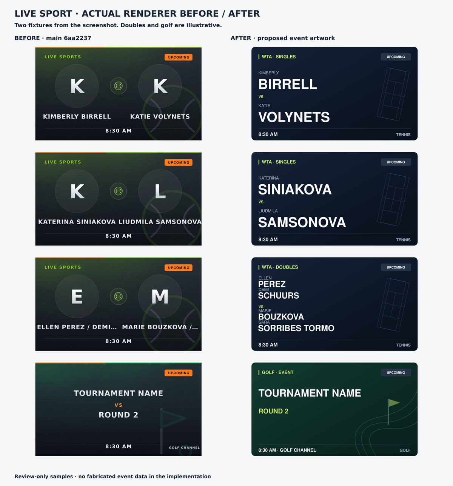

# Tennis and golf event artwork

Landscape artwork for dated live/upcoming tennis and golf events now leads with the players or event title. Tennis singles and doubles use readable name rows; compound name tokens are preserved. Golf uses its supplied title and optional title suffix, with a supplied channel/time in the footer. Missing metadata uses a generic event label; no round, venue, player photo or score is fabricated.

The two singles use players/time from the supplied screenshot. Doubles pairings and the golf title are illustrative review samples, not confirmed fixtures. Before is recreated from main6aa2237; after is generated by this implementation. Actual client fonts and catalogue scaling can vary.

## Scope and cache

- Catalog responses opt in only dated, non-terminal live/upcoming tennis/golf landscape events. Their provider artwork is replaced deliberately by the event card.
- Replays, 24/7/no-date entries, terminal events, portrait cards and other sports retain their existing provider priority and composer.
- `art=event-v3` opts in. Existing image URLs remain on the legacy composer. Qualifying new URLs use `v=3` and memo identity includes the artwork field.
- Event cards do not fetch logos, and their final text-only output is memoized. Cache TTL/capacity and image dimensions are unchanged.
- Existing client/CDN metadata caches may keep older poster URLs until their TTL expires.

## Validation

138 selected Jest tests pass:45 new composer/catalog/image-handler cases,12 existing match-card cases and81 guard/cache/retry controls. Catalog tests use a DI fixture; route tests evaluate the actual `/img/match` registration in isolation with the SVG fallback. They do not start the full app or prove HTTP/native playback integration.

Four supplied sample SVGs parse successfully and sharp renders JPEG quality85 at800×450:28,941 /35,263 /34,825 /28,769 bytes, below the existing256KiB route budget. These are sample payloads, not a general benchmark or before/after bandwidth gain. The comparison PNG is a documentation asset only.

Core patch applies to the exact heads of overlapping PRs #24/#25 (catalog.js) and #31 (index.js). This is an application check, not a merge or execution of all combined PRs. No pending branches were modified.

Full suite, build/dist, CI, native providers, Nuvio/device playback and deployment remain untested. Review layout in the target client before merging.

